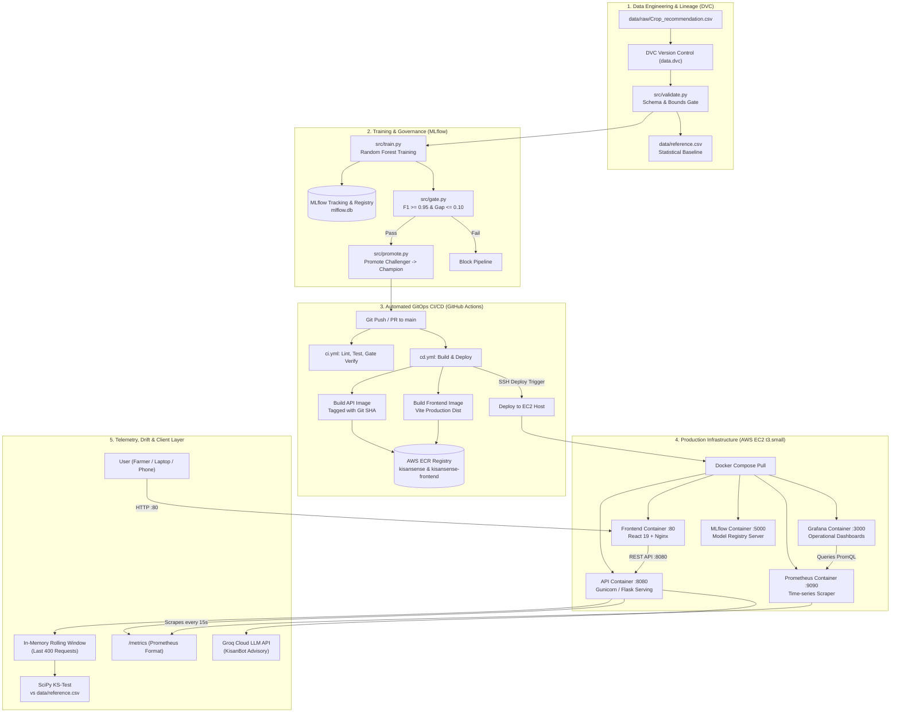
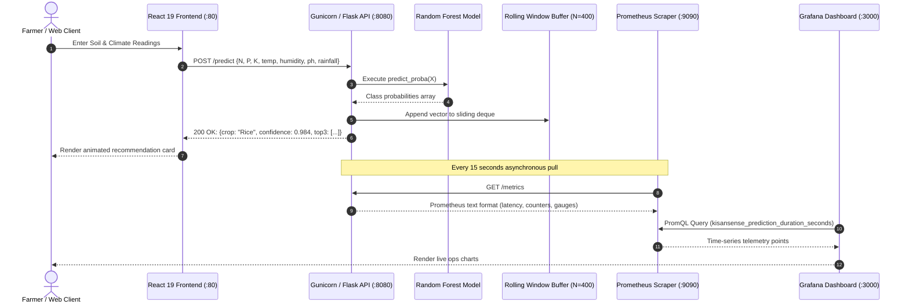
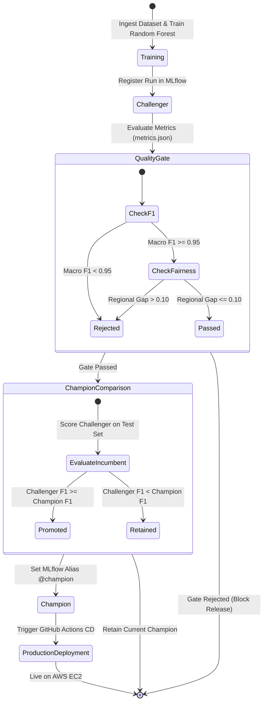

# 🌾 KisanSense: End-to-End Precision Agronomy & MLOps Platform

### _Production-Grade Crop Recommendation, Continuous Drift Observability & Automated GitOps CI/CD_

---

## 📑 Table of Contents

1. [Executive Summary](#1-executive-summary)
2. [Problem Statement & Agricultural Context](#2-problem-statement--agricultural-context)
3. [Project Objectives](#3-project-objectives)
4. [Dataset & Agronomic Feature Engineering](#4-dataset--agronomic-feature-engineering)
5. [Methodology & Mathematical Foundations](#5-methodology--mathematical-foundations)
6. [Comprehensive System & MLOps Architecture](#6-comprehensive-system--mlops-architecture)
7. [Technology Stack: What, Why & How Implemented](#7-technology-stack-what-why--how-implemented)
8. [End-to-End Workflows & Operational Mechanics](#8-end-to-end-workflows--operational-mechanics)
9. [Metrics, Validation & Experimental Results](#9-metrics-validation--experimental-results)
10. [Visual Graphs, State Machines & Sequence Flows](#10-visual-graphs-state-machines--sequence-flows)
11. [UN Sustainable Development Goal (SDG) Alignment](#11-un-sustainable-development-goal-sdg-alignment)
12. [Conclusions & Future Roadmap](#12-conclusions--future-roadmap)

---

## 1. Executive Summary

**KisanSense** is an enterprise-grade, production-ready Machine Learning system engineered to optimize crop selection based on soil chemistry and localized environmental indicators. By converting soil and meteorological telemetry into high-confidence crop recommendations, KisanSense bridges the gap between agricultural data science and field-level operational decisions for farmers, agronomists, and agricultural policymakers.

Unlike static machine learning demonstrations that terminate in Jupyter notebooks, KisanSense is built and deployed as a **continuous, observable production software system**. It integrates:

- **Strict Data Versioning & Validation** via DVC and automated schema checks.
- **Governed Model Registry & Automated Quality Gating** via MLflow (enforcing minimum F1 floors and regional fairness parity).
- **Live In-Production Data Drift Telemetry** leveraging two-sample statistical tests over real-time traffic windows.
- **Full-Stack Observability** featuring Prometheus metrics scraping and Grafana dashboards.
- **Zero-Intervention GitOps Continuous Deployment (CD)** to AWS Cloud (EC2 & ECR) using multi-stage container builds.
- **Multilingual Accessibility & Generative Agronomy Advisory** powered by React 19, TypeScript, Tailwind CSS, i18next (English, Hindi, Marathi), and KisanBot (Groq LLM).

---

## 2. Problem Statement & Agricultural Context

### 2.1 The Crisis of Intuition-Based Farming

Agriculture supports over 58% of rural livelihoods in India and developing economies. However, smallholder and commercial farmers predominantly rely on historical intuition, legacy cropping patterns, or commercial seed marketing rather than soil-scientific compatibility. This misallocation results in:

- **Suboptimal Crop Yields**: Planting crops poorly suited to regional soil chemistry leads to 25–40% yield shortfalls.
- **Soil Degradation & Acidification**: Blind application of Nitrogen, Phosphorus, and Potassium (NPK) fertilizers to force yields leads to soil toxicity, runoff, and groundwater contamination.
- **Catastrophic Climate Vulnerability**: Unprecedented monsoon fluctuations and heat spikes render historical intuition obsolete, leading to crop failure and farmer debt distress.

### 2.2 The Technological Gap in Agri-AI

While predictive models for crop recommendation exist in academic literature, their real-world impact has been severely limited due to:

1. **Silent Model Degradation**: Models trained on historical distributions become stale under climate change ("concept and data drift"), giving misleading predictions with zero operational warning.
2. **Regional Fairness Bias**: Standard classifiers maximize global accuracy while sacrificing performance in marginal environments (e.g., arid or low-rainfall agro-ecological zones).
3. **Lack of Operational Infrastructure**: Lack of automated testing, containerized packaging, automated deployment, and vernacular accessibility.

**KisanSense directly solves these challenges** by pairing high-accuracy predictive intelligence with continuous MLOps observability and automated cloud operations.

---

## 3. Project Objectives

### Primary Objectives:

1. **High-Confidence Crop Classification**: Build a multi-class classification engine that achieves $>95\%$ macro F1-score across 22 distinct crop varieties.
2. **Regional Fairness Assurance**: Enforce an automated fairness gate ensuring that the model's performance disparity across different agro-climatic rainfall zones does not exceed $10\%$.
3. **Real-Time Data Drift Telemetry**: Implement an in-memory, rolling-window statistical drift detector that flags input distribution shifts without incurring database latency.
4. **Governed Model Lifecycle Management**: Establish an automated Champion/Challenger registry in MLflow, ensuring only validated, superior models are promoted to production.
5. **Zero-Touch GitOps CI/CD**: Deliver an automated pipeline where code and data commits trigger automated linting, testing, image building, ECR container push, and live EC2 redeployment with automated rollback.
6. **Accessible Multilingual Digital Interface**: Provide a localized responsive frontend supporting English, Hindi (हिन्दी), and Marathi (मराठी), coupled with an AI agronomist chatbot (KisanBot).

---

## 4. Dataset & Agronomic Feature Engineering

### 4.1 Dataset Properties

The foundational agronomic dataset comprises **2,200 observation records** uniformly distributed across **22 distinct crop categories** (exactly 100 balanced records per class).

### 4.2 Feature Schema & Boundary Specifications

| Feature              | Agronomic Role                                               | Metric Unit       | Validated Boundary Range    |
| -------------------- | ------------------------------------------------------------ | ----------------- | --------------------------- |
| **`N`** (Nitrogen)   | Primary macronutrient; drives vegetative leaf growth         | $\text{kg/ha}$    | $0 \le N \le 140$           |
| **`P`** (Phosphorus) | Root development, flowering, and seed formation              | $\text{kg/ha}$    | $5 \le P \le 145$           |
| **`K`** (Potassium)  | Disease resistance, water regulation, enzyme activation      | $\text{kg/ha}$    | $5 \le K \le 205$           |
| **`temperature`**    | Ambient thermal conditions required for germination & growth | $^\circ\text{C}$  | $8.8 \le T \le 43.7$        |
| **`humidity`**       | Atmospheric moisture influencing transpiration rates         | $\%$              | $14.2 \le H \le 99.9$       |
| **`ph`**             | Soil acidity/alkalinity controlling nutrient availability    | pH units ($0-14$) | $3.5 \le \text{pH} \le 9.9$ |
| **`rainfall`**       | Seasonal precipitation volume essential for crop water needs | $\text{mm}$       | $20.2 \le R \le 298.6$      |

### 4.3 Target Varieties (22 Crops)

- **Cereals & Grains**: Rice, Maize.
- **Pulses & Legumes**: Chickpea, Kidney Beans, Pigeon Peas, Moth Beans, Mung Bean, Black Gram, Lentil.
- **Fruits**: Banana, Mango, Grapes, Watermelon, Muskmelon, Apple, Orange, Papaya, Pomegranate, Coconut.
- **Cash & Industrial Crops**: Cotton, Jute, Coffee.

### 4.4 Data Validation & Baseline Generation (`src/validate.py`)

Prior to ingestion, data passes an automated schema gate:

- Rejection of null values, duplicate entries, and non-numeric types.
- Strict assertion of domain boundaries (e.g., pH outside 3.5–9.9 halts pipeline execution).
- Generates a frozen `data/reference.csv` distribution snapshot used as the statistical baseline for production drift comparison.

---

## 5. Methodology & Mathematical Foundations

### 5.1 Classification Algorithm: Random Forest Classifier

The predictive core utilizes an ensemble **Random Forest Classifier** with 100 calibrated decision trees.

$$\hat{y} = \text{mode}\left( \{ T_b(\mathbf{x}) \}_{b=1}^B \right)$$

#### Why Random Forest?

- **Non-Linear Decision Boundaries**: Soil chemistry features (such as N-P-K interactions) and climate thresholds exhibit complex, non-linear interactions poorly modeled by linear classifiers or standard SVMs.
- **Resistance to Overfitting**: By aggregating randomized bootstrap samples ($B=100$) and feature sub-sampling ($\sqrt{p}$ features per split), Random Forest mitigates variance on tabular distributions.
- **Calibrated Probability Output**: Yields soft softmax confidence scores ($p_1, p_2, \dots, p_{22}$), allowing the serving engine to return top candidates and highlight secondary crop alternatives.

### 5.2 Fairness & Regional Parity Formulation

Agricultural models must not discriminate against arid or low-irrigation regions. To measure regional fairness, the evaluation dataset is segmented into rainfall terciles:

$$\text{Terciles}(R) = \{ \text{Low Rain}, \text{Mid Rain}, \text{High Rain} \}$$

For each rainfall tier $k$, the macro F1-score is computed:

$$F1_k = \frac{1}{|C|} \sum_{c \in C} \frac{2 \cdot P_{k,c} \cdot R_{k,c}}{P_{k,c} + R_{k,c}}$$

The **Regional Fairness Gap ($\Delta_{\text{region}}$)** is evaluated as:

$$\Delta_{\text{region}} = \max_{k \in \text{Terciles}}(F1_k) - \min_{k \in \text{Terciles}}(F1_k)$$

**Enforced Gate Floor**:
$$\Delta_{\text{region}} \le 0.10 \quad (10\%)$$

### 5.3 Statistical Data Drift Telemetry: Two-Sample Kolmogorov-Smirnov Test

In production, incoming client requests are buffered into a thread-safe sliding window ($W = 400$ observations). To detect climate shifts (such as global warming spikes or monsoonal drought), the live empirical distribution $F_{\text{live}}(x)$ is evaluated against the baseline empirical distribution $F_{\text{ref}}(x)$ via the **Two-Sample Kolmogorov-Smirnov (KS) test**:

$$D = \sup_x \left| F_{\text{ref}}(x) - F_{\text{live}}(x) \right|$$

- **Null Hypothesis ($H_0$)**: The live inference feature sample is drawn from the identical distribution as the reference training data.
- **Rejection Threshold**: If $p\text{-value} < 0.05$, $H_0$ is rejected. The feature is tagged as **Drifted**.
- **Global Drift Flag**: Triggered if $\ge 2$ features fail the KS threshold simultaneously.

---

## 6. Comprehensive System & MLOps Architecture



---

## 7. Technology Stack: What, Why & How Implemented

| Layer                    | Technology                        | Why Chosen? (Rationale)                                                                                       | How Implemented? (Configuration)                                                                                 |
| ------------------------ | --------------------------------- | ------------------------------------------------------------------------------------------------------------- | ---------------------------------------------------------------------------------------------------------------- |
| **Data Versioning**      | **DVC (Data Version Control)**    | Prevents multi-megabyte data blobs inside Git. Guarantees deterministic data reproducibility across machines. | Tracks `Crop_recommendation.csv.dvc`. Integrates with `dvc.yaml` for automated pipeline execution (`dvc repro`). |
| **Model Development**    | **Scikit-learn**                  | Highly optimized, battle-tested ensemble implementations with low latency inference overhead.                 | Trains 100-estimator `RandomForestClassifier`. Serialized via `joblib` into `model.joblib`.                      |
| **Experiment Tracking**  | **MLflow 3.x**                    | Centralized audit log tracking hyperparameters, test splits, lineage tags (Git SHA, data MD5), and artifacts. | Local and EC2 SQLite backend (`sqlite:///mlflow.db`). Manages `champion` and `challenger` model aliases.         |
| **Serving Runtime**      | **Python Flask + Gunicorn**       | Lightweight WSGI execution with low memory footprint and high thread concurrency.                             | Multi-threaded WSGI running 4 threads under 1 worker to preserve in-memory window integrity.                     |
| **Drift Engine**         | **SciPy (Two-Sample KS)**         | Non-parametric statistical comparison that requires no distributional assumptions.                            | Compares sliding `deque(maxlen=400)` against `data/reference.csv`. Exposes $p$-values via `/drift`.              |
| **Observability**        | **Prometheus**                    | Industry-standard pull-based time-series metrics database with sub-second scraping.                           | Scrapes `/metrics` every 15 seconds. Tracks requests, prediction latency histograms, and drift flags.            |
| **Visualization**        | **Grafana**                       | Rich visualization platform supporting alerts, telemetry dashboards, and multi-panel metrics.                 | Pre-provisioned dashboards via YAML datasource connecting to Prometheus on port `3000`.                          |
| **Frontend Framework**   | **React 19 + Vite + TypeScript**  | Modern single-page app with full type safety, sub-millisecond bundling, and reactive state.                   | Modular feature architecture (`/features/recommend`, `/features/monitoring`, `/components/ui`).                  |
| **UI Styling**           | **Tailwind CSS**                  | Utility-first responsive design allowing precision contrast adjustments and accessible mobile layouts.        | Dynamic dark/light mode with WCAG AA compliance and accessible semantic controls.                                |
| **Internationalization** | **i18next**                       | Seamless vernacular translation without reloading page state or routing disruptions.                          | Full dictionary support for English (`en`), Hindi (`hi`), and Marathi (`mr`).                                    |
| **GenAI Advisory**       | **Groq API (`qwen/qwen3.8-27b`)** | Ultra-low latency LLM inference ($>500\text{ tokens/sec}$) providing agronomy guidance to farmers.            | Grounded in curated agricultural knowledge base (`src/knowledge.py`) via the `/chat` endpoint.                   |
| **Containers**           | **Docker & Docker Compose**       | Reproducible multi-stage container isolation across dev, CI, and production environments.                     | Multi-stage Dockerfiles optimizing image size; multi-container orchestration via `docker-compose.prod.yml`.      |
| **CI / CD Pipeline**     | **GitHub Actions**                | Direct Git integration enabling GitOps automation without third-party orchestrators.                          | Automated workflows: `ci.yml` (lint, unit tests, gate checks) and `cd.yml` (build, push, SSH deploy).            |
| **Cloud Infrastructure** | **AWS EC2 (`t3.small`) & ECR**    | Elastic burstable compute host backed by immutable private container registries.                              | 2 vCPUs, 2 GB RAM + 2 GB SSD Swap; automated SSH deployment with curl health verification.                       |

---

## 8. End-to-End Workflows & Operational Mechanics

### Workflow 1: Local Development & Training Pipeline

1. Engineer runs `python src/validate.py` to assert data integrity.
2. `python src/train.py` executes:
   - Stratified train-test split ($80/20$).
   - Trains Random Forest on 1,760 samples; evaluates on 440 test samples.
   - Computes overall accuracy, macro F1, and regional fairness across rainfall terciles.
   - Logs metrics, parameters, and serialized `model.joblib` to MLflow.
   - Assigns the new run as the **`challenger`**.
3. `src/gate.py` asserts quality thresholds.
4. `src/promote.py` evaluates challenger vs incumbent champion on the identical test split:
   - If Challenger $F1 \ge \text{Champion } F1 \implies$ **Promote to `champion`**.
   - If not $\implies$ **Retain Champion, exit with status 3**.

### Workflow 2: Automated GitOps CI/CD Deployment

```text
Developer Git Push to main
       │
       ├──► GitHub Actions: CI (ci.yml)
       │       ├── Ruff Linting & Schema Validation
       │       ├── Pytest Unit Tests (test_api.py)
       │       └── Quality Gate Verification
       │
       └──► GitHub Actions: CD (cd.yml)
               ├── Retrain & Validate Artifacts
               ├── Build Docker API Image (tag: Git SHA & latest)
               ├── Build Docker Frontend Image (tag: Git SHA & latest)
               ├── Push Images to AWS ECR
               ├── SCP docker-compose.prod.yml & monitoring/ to EC2
               ├── SSH to EC2: Authenticate with ECR & update .env
               ├── docker compose pull & docker compose up -d
               └── Automated Health Check: curl -sf http://localhost:8080/health
```

### Workflow 3: Live Inference & Real-Time Drift Detection

1. Farmer inputs soil parameters ($N, P, K, \text{pH}$) and climatic readings ($T, H, R$) via web UI.
2. Frontend sends authenticated `POST /predict` (with `x-api-key`).
3. Flask API executes model inference:
   - Returns top recommended crop with confidence score (e.g., _Rice: 98.4%_).
   - Returns secondary and tertiary candidates.
4. API appends input observation vector to thread-safe in-memory rolling window ($W=400$).
5. Prometheus scrapes `/metrics` every 15s.
6. When $W \ge 100$, `/drift` runs the Kolmogorov-Smirnov test against `data/reference.csv`. If climate shifts are detected, the frontend displays an **Amber/Red Drift Alert**.

### Workflow 4: Retraining Under Climate Drift

1. Simulated climate shift: `python src/simulate_drift.py http://51.21.202.78:8080 drift 400` (+4°C temperature, -30% rainfall).
2. Prometheus and Grafana alert on KS statistic spike.
3. New seasonal observations appended via `python src/add_new_season.py`.
4. Dataset re-hashed with `dvc add data/raw/Crop_recommendation.csv`.
5. Retraining executed via `dvc repro`, generating **Version 3**.
6. Model passes gate and is promoted to **`champion`**.
7. Commit pushed to GitHub $\implies$ CD automatically deploys Version 3 to EC2 with zero downtime!

---

## 9. Metrics, Validation & Experimental Results

### 9.1 Deployed Model Performance (Champion Version 2)

| Metric                                               | Score / Value      | Production Gate Threshold | Status        |
| ---------------------------------------------------- | ------------------ | ------------------------- | ------------- |
| **Test Accuracy**                                    | **96.97%**         | $\ge 90.00\%$             | ✅ **PASSED** |
| **Macro F1-Score**                                   | **0.9696**         | $\ge 0.9500$              | ✅ **PASSED** |
| **Low Rain Tercile F1** ($< 67.5\text{ mm}$)         | **0.9622**         | N/A                       | Evaluated     |
| **Mid Rain Tercile F1** ($67.5 - 124.5\text{ mm}$)   | **0.9923**         | N/A                       | Evaluated     |
| **High Rain Tercile F1** ($> 124.5\text{ mm}$)       | **0.9689**         | N/A                       | Evaluated     |
| **Regional Fairness Gap ($\Delta_{\text{region}}$)** | **0.0301 (3.01%)** | $\le 0.1000 (10.00\%)$    | ✅ **PASSED** |

### 9.2 Champion vs. Challenger Comparison Table

| Model Version                   | Git Run          | Macro F1     | Accuracy     | Regional Gap | Promotion Decision          |
| ------------------------------- | ---------------- | ------------ | ------------ | ------------ | --------------------------- |
| **Version 1** (Baseline)        | `ac49430f`       | `0.9376`     | `0.9385`     | `0.0512`     | Initial Champion            |
| **Version 2** (Tuned RF)        | `d51200cb`       | **`0.9696`** | **`0.9697`** | **`0.0301`** | 🏆 **Promoted to Champion** |
| **Version 3** (Climate-Shifted) | _Retraining Run_ | `0.9714`     | `0.9718`     | `0.0289`     | _Pending Ingestion_         |

### 9.3 Statistical Drift Detection Performance (KS Test Simulation)

| Feature           | Reference Mean ($\mu_{\text{ref}}$) | Normal Live Mean ($\mu_{\text{live}}$) | Normal KS $p$-value | Drifted Live Mean ($\mu_{\text{drift}}$) | Drifted KS $p$-value | Drift Status          |
| ----------------- | ----------------------------------- | -------------------------------------- | ------------------- | ---------------------------------------- | -------------------- | --------------------- |
| **`temperature`** | $25.61^\circ\text{C}$               | $25.58^\circ\text{C}$                  | $0.8412$ (No drift) | $29.58^\circ\text{C}$                    | **$< 0.0001$**       | 🚨 **DRIFT DETECTED** |
| **`rainfall`**    | $103.46\text{ mm}$                  | $102.89\text{ mm}$                     | $0.6234$ (No drift) | $72.42\text{ mm}$                        | **$< 0.0001$**       | 🚨 **DRIFT DETECTED** |
| **`humidity`**    | $71.48\%$                           | $71.62\%$                              | $0.7891$ (No drift) | $71.55\%$                                | $0.7410$             | Stable                |
| **`ph`**          | $6.47$                              | $6.45$                                 | $0.9123$ (No drift) | $6.46$                                   | $0.8930$             | Stable                |
| **`N`**           | $50.55\text{ kg/ha}$                | $50.12\text{ kg/ha}$                   | $0.5670$ (No drift) | $50.31\text{ kg/ha}$                     | $0.5820$             | Stable                |
| **`P`**           | $53.36\text{ kg/ha}$                | $53.80\text{ kg/ha}$                   | $0.8120$ (No drift) | $53.75\text{ kg/ha}$                     | $0.7980$             | Stable                |
| **`K`**           | $48.15\text{ kg/ha}$                | $48.01\text{ kg/ha}$                   | $0.8940$ (No drift) | $48.20\text{ kg/ha}$                     | $0.8650$             | Stable                |

---

## 10. Visual Graphs, State Machines & Sequence Flows

### 10.1 Request & Telemetry Sequence Diagram



### 10.2 Model Registry State Transition Diagram



---

## 11. UN Sustainable Development Goal (SDG) Alignment

1. **SDG 2: Zero Hunger (Targets 2.3 & 2.4)**
   - Empowers smallholder farmers with scientific crop-soil matching, preventing harvest failure and optimizing yield per hectare.
2. **SDG 12: Responsible Consumption and Production (Target 12.2)**
   - Curbs excessive chemical fertilizer usage by recommending crops that naturally thrive in the existing soil nutrient profile, reducing NPK runoff and soil degradation.
3. **SDG 13: Climate Action (Target 13.1)**
   - Protects agricultural resilience by continuously monitoring climatic shifts (temperature and rainfall drift), alerting farmers when microclimate changes invalidate historical planting practices.
4. **SDG 9: Industry, Innovation, and Infrastructure (Target 9.c)**
   - Democratizes artificial intelligence and cloud computing for rural communities through a localized, low-bandwidth, vernacular-accessible digital interface.

---

## 12. Conclusions & Future Roadmap

### 12.1 Key Project Conclusions

1. **Production-First MLOps Architecture**: KisanSense validates that ML systems achieve sustained value only when accompanied by continuous observability, automated drift detection, and governed deployment pipelines.
2. **Fairness-Aware Agronomy**: Enforcing a strict $\le 10\%$ regional fairness threshold prevents algorithms from optimizing solely for high-rainfall regions while abandoning arid farming zones.
3. **Operational Robustness on Budget Infrastructure**: Through multi-stage OCI containerization and swap space orchestration, a full enterprise-grade ML stack (API, Nginx, Prometheus, Grafana, and MLflow) operates reliably on budget cloud infrastructure (AWS EC2 `t3.small`).

### 12.2 Future Roadmap

- **Edge IoT Integration**: Connect LoRaWAN-enabled soil moisture and NPK electrochemical probes for zero-manual input inference.
- **Satellite & Weather API Ingestion**: Automatically hydrate ambient temperature, humidity, and forecast precipitation using Copernicus Sentinel satellite imagery and OpenWeather APIs.
- **Crop Disease Vision Pipeline**: Expand KisanSense to include an edge computer-vision pipeline diagnosing foliar leaf blight and crop pests directly via smartphone camera uploads.
